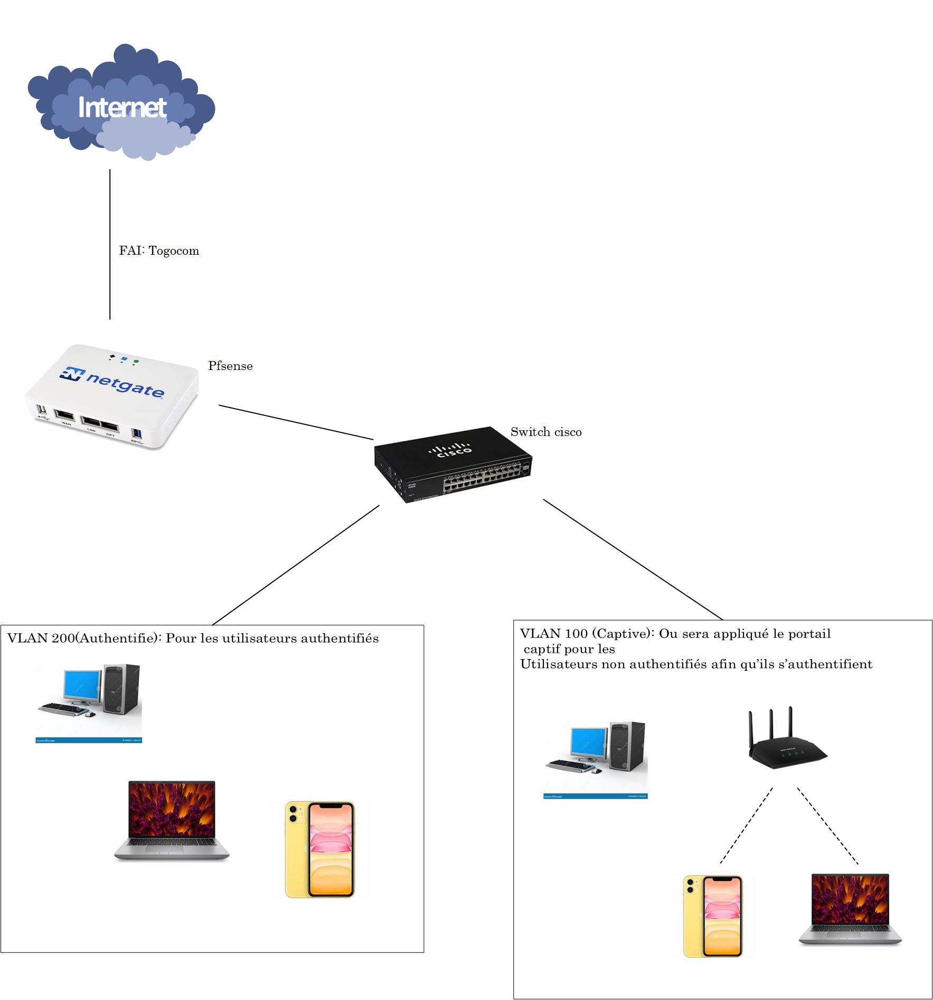

## Context

My first-year school project (PPE): control who gets Internet access on a network. A user who connects is redirected to a login page and has no access until they authenticate.

## Design

The target design uses a pfSense firewall between the Internet link and a switch, with two VLANs: one where the captive portal applies to users who are not authenticated yet, and one for authenticated users.

I built and tested it as a virtual lab: a pfSense VM with a WAN interface and an internal LAN segment, plus client VMs on that segment.

## What I did

- Installed **pfSense** and configured its WAN and LAN interfaces.
- Set up the **DHCP server** on the LAN so that clients receive an address, gateway and DNS automatically.
- Created user accounts in the pfSense **local user database** and selected it as the portal's authentication method.
- Enabled a **captive portal zone** on the LAN interface.
- Wrote **firewall rules** on the LAN: allow HTTP and HTTPS, block everything else.
- Built a **custom login page** in HTML, using the placeholders pfSense expects for the form action and the redirect URL, and uploaded it to the portal.
- Wrote the **deployment manual** covering all of the above.

## What I learned

- How DHCP, DNS, the firewall rules and the portal depend on each other: a client that gets no address or no DNS never even reaches the login page.
- Firewall rules are evaluated in order — the general block rule has to sit below the rules that allow traffic.
