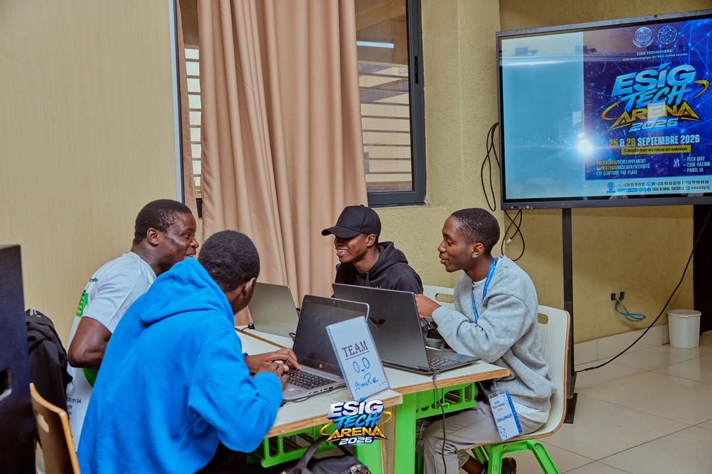
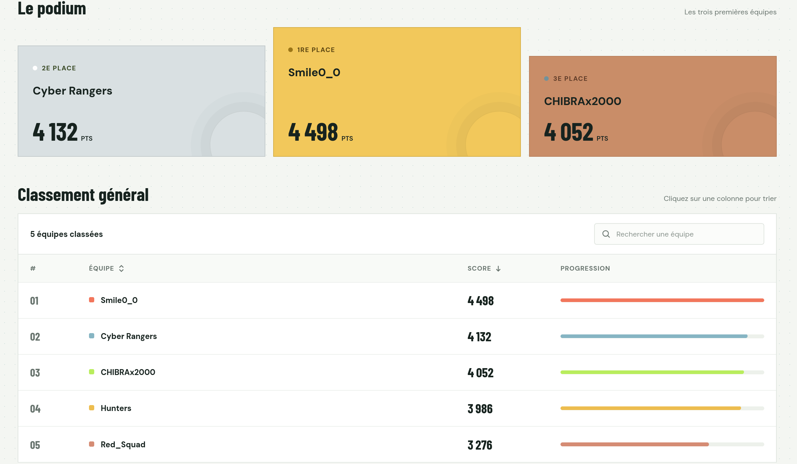

L'équipe **Smile 0_0** a terminé **1re des qualifications** avec 5797 points, puis a **remporté la finale de 24 heures**, disputée les 25 et 26 septembre 2026, avec 4498 points — 1re sur les 5 équipes qualifiées. J'ai joué sous le pseudo **r0r0** du début à la fin.

La finale mêlait des challenges de type Jeopardy à une épreuve de revue de code (Code Review) et à une épreuve « Bypass AV » — un format plus large que celui des qualifications.
