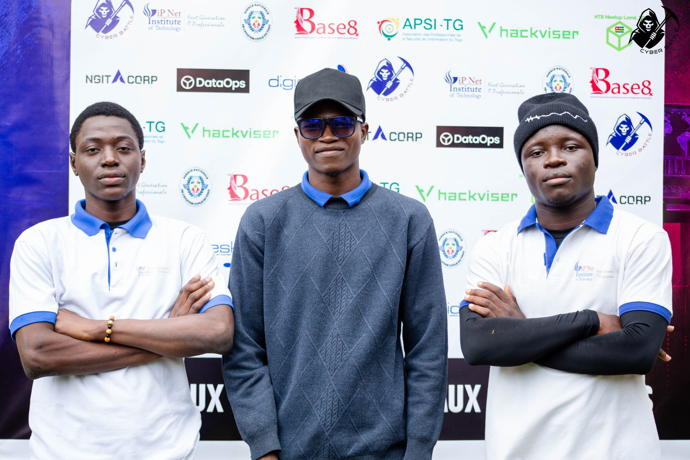
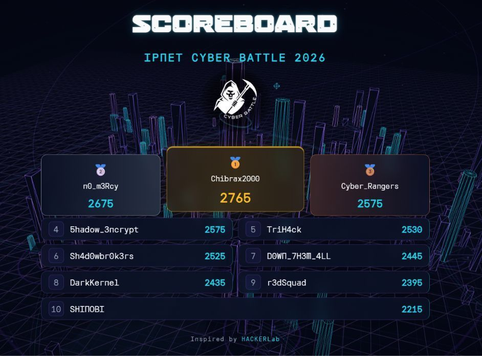

Un CTF de 24 heures. J'ai représenté l'équipe **n0_m3rcy**, qui a terminé à la **2e place** avec **2675 points**, à 90 points de l'équipe gagnante.

Les épreuves étaient variées : exploitation web, stéganographie, forensique, machines Boot2Root, revue de code, une épreuve « Virtuoso » et même une catégorie physique de crochetage de serrures — un bon test d'endurance et de la façon dont une équipe se répartit le travail sur 24 heures.
