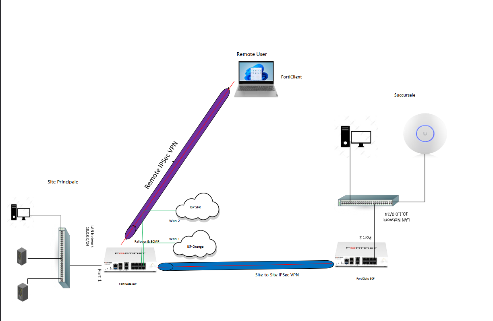

## Contexte

Un scénario de lab : une entreprise veut moderniser l'interconnexion entre son siège et une succursale, et donner un accès sécurisé à ses collaborateurs à distance. Le siège dispose de deux fournisseurs d'accès à Internet, et la liaison doit survivre à la perte de l'un ou de l'autre.

Trois objectifs :

1. **Redondance WAN** — SD-WAN sur le pare-feu du siège, avec bascule (failover) et répartition de charge (ECMP) entre les deux FAI.
2. **Confidentialité inter-sites** — un VPN IPsec entre les deux sites, qui continue de fonctionner quand un FAI tombe.
3. **Mobilité sécurisée** — un VPN d'accès distant pour les utilisateurs nomades.

## Topologie

| Site | LAN | WAN |
| --- | --- | --- |
| Siège | `10.0.0.0/24` | WAN1 `192.168.56.10`, WAN2 `192.168.56.20` |
| Succursale | `10.1.0.0/24` | `192.168.56.30` |
| Utilisateurs distants | plage `10.212.134.100–200` | FortiClient |

L'ensemble tourne sur deux VM FortiGate, avec un réseau virtuel qui joue le rôle d'Internet et un réseau par LAN.

## Ce que j'ai fait

### SD-WAN au siège

- Création d'une zone SD-WAN avec les deux interfaces WAN comme membres, à priorité et coût égaux pour que le trafic soit réparti (ECMP).
- Remplacement des routes par défaut par interface par une seule route statique par défaut pointant vers la zone SD-WAN, et une règle de pare-feu du LAN vers cette zone avec NAT.
- Ajout d'un **Performance SLA** (test de santé par ping vers une adresse publique) pour qu'un lien mort soit retiré automatiquement de la table de routage.

### VPN IPsec site à site par-dessus le SD-WAN

- Siège : deux tunnels, un par FAI, en mode dial-up. Succursale : deux tunnels statiques, un vers chaque adresse WAN du siège, en auto-négociation pour que ce soit la succursale qui initie.
- De chaque côté, les deux interfaces de tunnel sont regroupées dans une seconde zone SD-WAN, avec une route statique vers le LAN distant à travers cette zone, un Performance SLA qui ping l'adresse LAN du pare-feu distant, et une règle SD-WAN qui privilégie le premier FAI.
- Des règles de pare-feu dans les deux sens entre le LAN et la zone VPN, sans NAT.

### Accès distant

- Des utilisateurs locaux dans un groupe `VPN_Users`, un tunnel IPsec d'accès distant (IKEv2, clé pré-partagée et authentification utilisateur) qui distribue les adresses de la plage VPN, et une règle du tunnel vers le LAN.
- Configuration de FortiClient sur un poste client pour se connecter au siège.

## Résultats

- **Bascule WAN** : avec un ping continu depuis un client du LAN, j'ai désactivé WAN1. Aucun paquet perdu, le SLA montrait tout le trafic passant sur WAN2, et les journaux de trafic montraient le changement d'interface de sortie.
- **Site à site** : les machines des deux LAN se joignent à travers le tunnel. Après la coupure de WAN1, le second tunnel s'est négocié et le trafic a basculé dessus.

## Ce que j'ai appris

- **Deux interfaces dans le même sous-réseau sont refusées par défaut.** FortiOS veut que chaque interface soit dans son propre sous-réseau pour router sans ambiguïté ; comme mon lab plaçait les deux WAN sur un même réseau host-only, j'ai dû activer `allow-subnet-overlap` en CLI.
- **Une interface ne peut pas rejoindre une zone SD-WAN tant qu'elle est encore référencée** par une règle de pare-feu ou une route statique : il faut d'abord les supprimer.
- **Un seul des deux tunnels site à site est actif à la fois.** Les deux tunnels ciblent le même sous-réseau distant, donc le pare-feu garde un seul chemin actif ; le second ne se négocie que lorsque le premier tombe. Le test de bascule a confirmé que c'est le comportement attendu, pas une panne.
