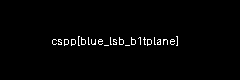

## Informations

- **Catégorie :** Steganography
- **Difficulté :** Medium
- **Points :** 85
- **Auteur du write-up :** 3ch0
- **Flag :** `cspp{blue_lsb_b1tplane}`

> **Énoncé :** The secret hides in a single bit-plane of this image — invisible in the normal view. Isolate the least-significant bit of the blue channel (set that bit to white, everything else black) and the flag appears as readable text.

---

## 1. Analyse

L'image `planes.png` paraît normale à l'œil. L'énoncé indique que le secret est caché dans **un seul bit-plane** : précisément le **bit de poids faible (LSB) du canal bleu**. En isolant ce bit (bit à 1 → blanc, bit à 0 → noir), le flag doit apparaître comme du texte lisible.

---

## 2. Première approche — zsteg

On tente une extraction automatique des plans LSB avec `zsteg` :

```bash
zsteg planes.png
```

```text
b1,bgr,lsb,xy       .. text: "Q,&\nl0H,4BD"
b2,bgr,lsb,xy       .. file: OpenPGP Secret Key
b4,b,lsb,xy         .. text: "\nDj$(b(H"
...
```

`zsteg` ne renvoie que du charabia et de faux positifs (« OpenPGP »). **C'est attendu** : le flag n'est pas encodé sous forme d'octets dans le plan, il y est **dessiné en pixels** (du texte tracé). L'extraction octet-par-octet ne peut donc rien produire de lisible — il faut *visualiser* le plan, pas le décoder.

> `foremost` ne donne rien d'utile non plus (mêmes raisons : aucun fichier concaténé à extraire).

---

## 3. Solution — visualisation du bit-plane

On isole visuellement le LSB du canal bleu avec un visualiseur de plans de bits :

- **Aperi'Solve** ([aperisolve.com](https://aperisolve.com)) — analyse en ligne qui affiche automatiquement tous les bit-planes de chaque canal (R, G, B).

On charge l'image, puis on regarde le plan **Blue → bit 0 (LSB)**. Le flag apparaît alors en clair, tracé en texte :

```text
cspp{blue_lsb_b1tplane}
```

> **Outils équivalents :** **StegSolve** (Java, navigation plan par plan avec les flèches) ou un script Python.

### Extraction du plan en Python

```python
from PIL import Image

img = Image.open("planes.png").convert("RGB")
w, h = img.size
out = Image.new("1", (w, h))               # image noir & blanc

px, po = img.load(), out.load()
for y in range(h):
    for x in range(w):
        r, g, b = px[x, y]
        po[x, y] = (b & 1) * 255           # LSB du canal bleu → blanc si 1, noir sinon

out.save("blue_lsb.png")                    # ouvrir → le flag est lisible
```



---

## Récapitulatif

1. Image d'apparence normale, secret caché dans **un bit-plane**.
2. `zsteg` / `foremost` → **échec attendu** : le flag est dessiné en pixels, pas encodé en octets.
3. Visualisation du plan **LSB du canal bleu** (Aperi'Solve / StegSolve / Python) → flag lisible.

> **Concept clé :** un pixel se décompose en plans de bits par canal. Le LSB est invisible à l'œil (il modifie la couleur de façon imperceptible), mais en le forçant en noir & blanc on révèle ce qui y a été *tracé*. Distinguer un secret **encodé** (octets → `zsteg`) d'un secret **dessiné** (pixels → visualiseur) est la clé de ce type de challenge.

---

***— 3ch0***
