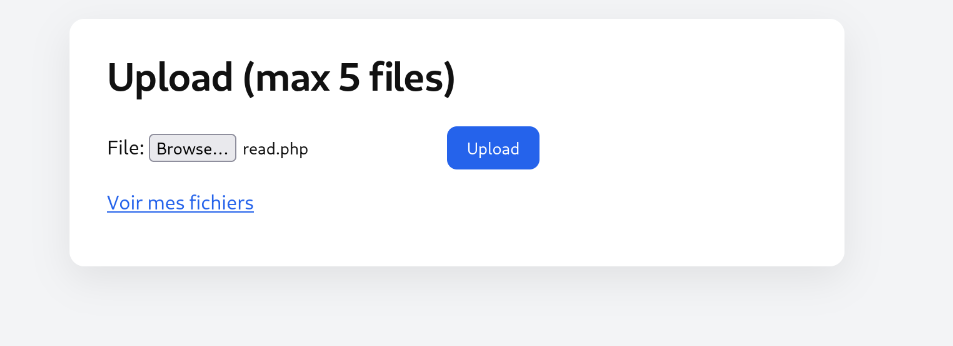
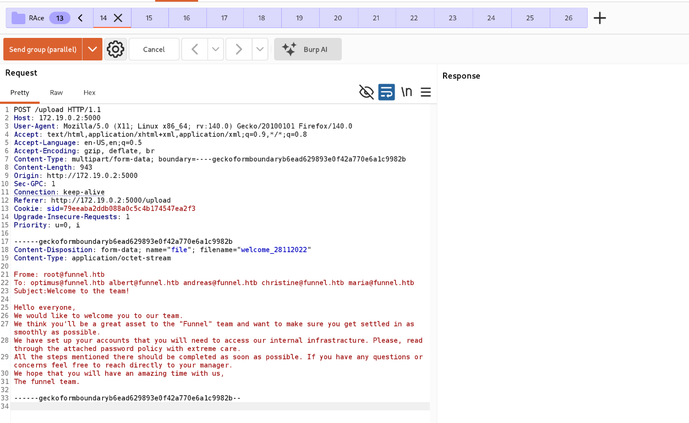
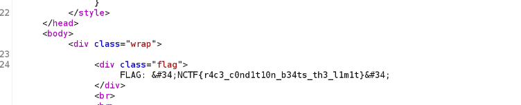

> Plateforme : **NCTF** — Challenge web (lab Docker local, port 5000)

## Informations

- **Catégorie :** Web (Race condition — TOCTOU)
- **Difficulté :** Moyenne
- **Auteur du write-up :** 3ch0
- **Stack :** Flask / Werkzeug 3.1 / Python 3.11
- **Flag :** `NCTF{r4c3_c0nd1t10n_b34ts_th3_l1m1t}`

---

## 1. Reconnaissance

La page expose un formulaire d'upload avec une limite affichée : **« Upload (max 5 files) »**.

```text
POST /            (multipart/form-data, champ "file")
GET  /my_files    (liste des fichiers uploadés)
```

Un upload normal ne mène à rien : pas d'exécution, pas d'inclusion, le fichier est juste stocké. Le seul élément remarquable est la **limite de 5 fichiers** — et un challenge qui insiste sur une limite, c'est une invitation à la **contourner**.



---

## 2. Hypothèse : TOCTOU sur le compteur

La vérification côté serveur ressemble à :

```python
if count_files(user) < 5:      # TIME-OF-CHECK
    save(file)                 # TIME-OF-USE
    count += 1
```

Entre le **moment où le compteur est lu** (check) et le **moment où le fichier est écrit** (use), il y a une fenêtre. Si plusieurs requêtes arrivent **en même temps**, elles lisent toutes `count = 4 < 5` **avant** qu'aucune n'ait incrémenté → toutes passent → on dépasse la limite. C'est une **race condition de type TOCTOU**.

---

## 3. Exploitation — Burp (Send group in parallel)

1. Uploader normalement un fichier, **intercepter** la requête `POST /` dans Burp.
2. L'envoyer vers **Repeater** (`Ctrl+R`).
3. Dupliquer l'onglet une douzaine de fois (clic droit → *Duplicate tab*, ~12×).
4. Sélectionner les onglets dans un **même groupe**.
5. Lancer **« Send group in parallel »**.



Le choix **parallel** est essentiel : il déclenche le **single-packet attack** (si HTTP/2) ou le **last-byte sync** (HTTP/1.1), qui alignent l'arrivée des requêtes pour réduire la désynchronisation quasi à zéro. Un envoi *en séquence* (single connection) échouerait — les requêtes seraient traitées l'une après l'autre, chacune voyant le compteur déjà incrémenté.

---

## 4. Résultat — la limite est dépassée

Plusieurs uploads passent simultanément ; le nombre de fichiers franchit 5. Le serveur, détectant l'état incohérent (limite dépassée), révèle le flag dans la réponse :

```text
HTTP/1.1 200 OK
Server: Werkzeug/3.1.9 Python/3.11.17
...
<div class="flag">FLAG: "NCTF{r4c3_c0nd1t10n_b34ts_th3_l1m1t}"</div>
<h1>Upload (max 5 files)</h1>
```



**Flag :** `NCTF{r4c3_c0nd1t10n_b34ts_th3_l1m1t}`

---

## Récapitulatif

1. Formulaire d'upload avec **limite de 5 fichiers**, sans autre vecteur apparent.
2. Hypothèse **TOCTOU** : fenêtre entre la lecture du compteur et l'écriture du fichier.
3. Burp Repeater → ~12 onglets groupés → **Send group in parallel** (single-packet attack).
4. Les uploads concurrents dépassent la limite → le flag apparaît.

> **Concept clé :** une **race condition TOCTOU** (Time-Of-Check to Time-Of-Use) naît quand une vérification et l'action qu'elle protège ne sont **pas atomiques**. Ici, lire le compteur (`< 5`) puis enregistrer le fichier sont deux étapes distinctes : en envoyant N requêtes **simultanément**, toutes franchissent le test avant la première incrémentation, et la limite saute. L'outil clé est l'envoi **parallèle** de Burp, qui synchronise l'arrivée des requêtes (single-packet attack en HTTP/2, last-byte sync en HTTP/1.1) — un envoi séquentiel ne reproduit pas la condition. Défense : rendre le contrôle **atomique** (verrou applicatif, transaction base de données avec contrainte d'unicité ou `SELECT ... FOR UPDATE`, ou compteur incrémenté atomiquement **avant** le traitement), plutôt qu'un `if compteur < max` suivi d'une écriture séparée.

---

***— 3ch0***
